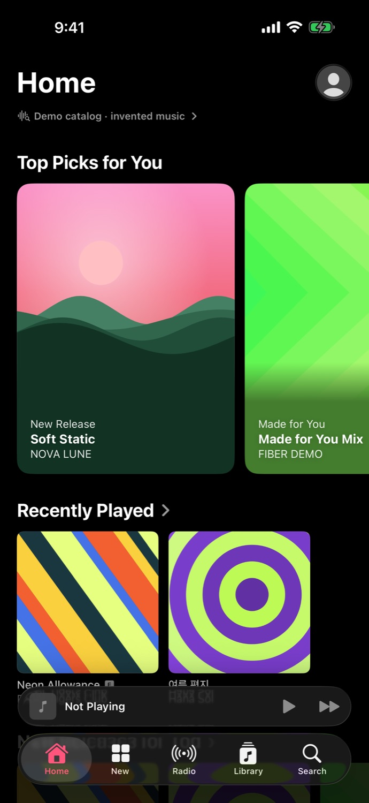
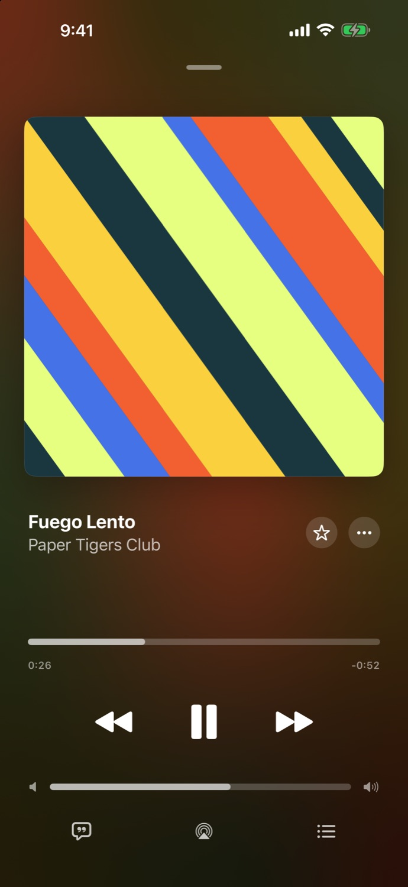
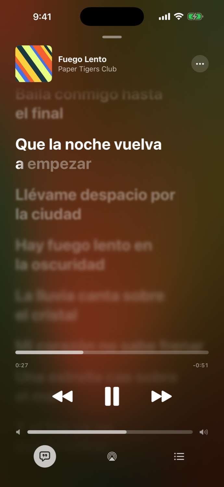
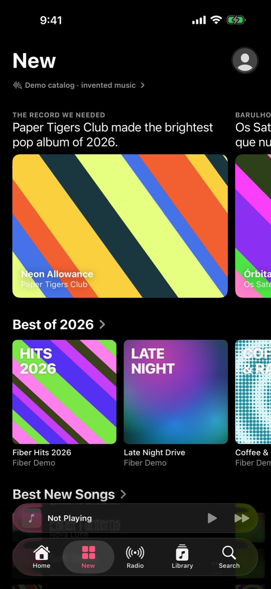

# Fiber

Music for iPhone, iPad, and Mac. The song plays here, the queue stays here, and the lyrics are big enough to read.

[](https://github.com/staraepp/fiber/releases/tag/v0.1.0)
[](LICENSE)
[](https://github.com/staraepp/fiber/stargazers)

<table>
  <tr>
    <td></td>
    <td></td>
    <td></td>
    <td></td>
  </tr>
  <tr>
    <td align="center">Home</td>
    <td align="center">Now playing</td>
    <td align="center">Lyrics</td>
    <td align="center">New</td>
  </tr>
</table>

Those shots are the demo that ships with Fiber. The artists are invented, the covers are drawn on the device, and the songs are real audio. Every tab says so. Turn the demo off in Settings when you want a quiet library.

## Listening

Five tabs: Home, New, Radio, Library, Search. A mini-player floats over them. Open a song and the full player takes the screen, with shuffle, repeat one, and repeat queue.

Lyrics can be timed to the word when the song has that information. Your own MP3, AAC, ALAC, FLAC, WAV, and AIFF files import from Library. Drop a `.lrc` next to a file and Fiber uses it. The equalizer applies to those files and to the demo.

On a Mac the player splits: cover on the left, lyrics on the right.

## Accounts

Settings, then Music Services. Anything switched off is left alone.

Apple Music uses MusicKit, so a signed build and a subscription are what play the catalog. Spotify plays inside Fiber and needs Premium. The first song asks you to enable audio once. YouTube Music signs in with the Google account that holds the library, and Fiber plays the audio itself. If a song cannot be streamed, Fiber says so.

## Build

Xcode 27, [XcodeGen](https://github.com/yonaskolb/XcodeGen), iOS 26. Nothing else to install.

```sh
xcodegen generate
open Fiber.xcodeproj
```

Run the Fiber scheme.

Keys never go in git. Copy `.env.example` to `.env`, then run `scripts/prepare_music_token.py` and `scripts/prepare_spotify_config.py`. For your phone, copy `Config/Signing.example.xcconfig` to `Config/Signing.xcconfig` and put your team id in it. `scripts/package_ipa.sh` and `scripts/package_mac.sh` write into `.build/`, which stays off this repo. An IPA from that script contains your own developer token, so pass it only to people you trust.

## License

Copyright (C) 2026 Star.

Fiber is free software under the [GNU General Public License v3.0](LICENSE). Use it, share it, change it. If you pass on a changed copy, pass on the source under the same license.
